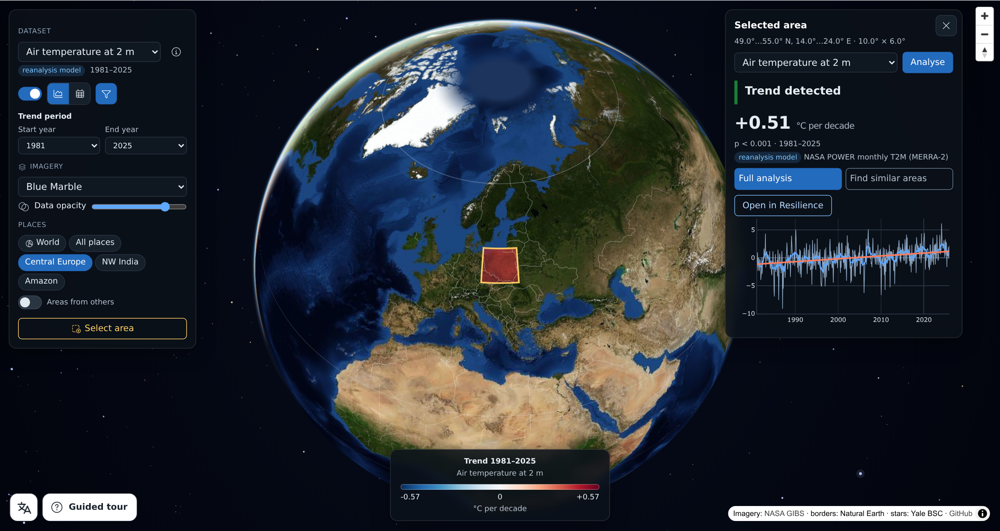
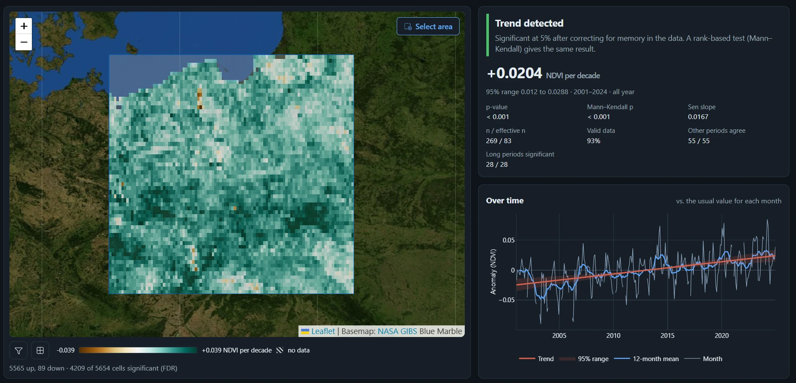
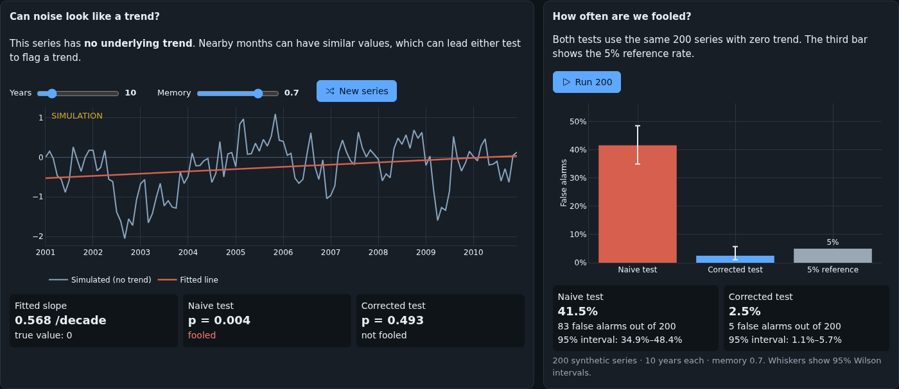
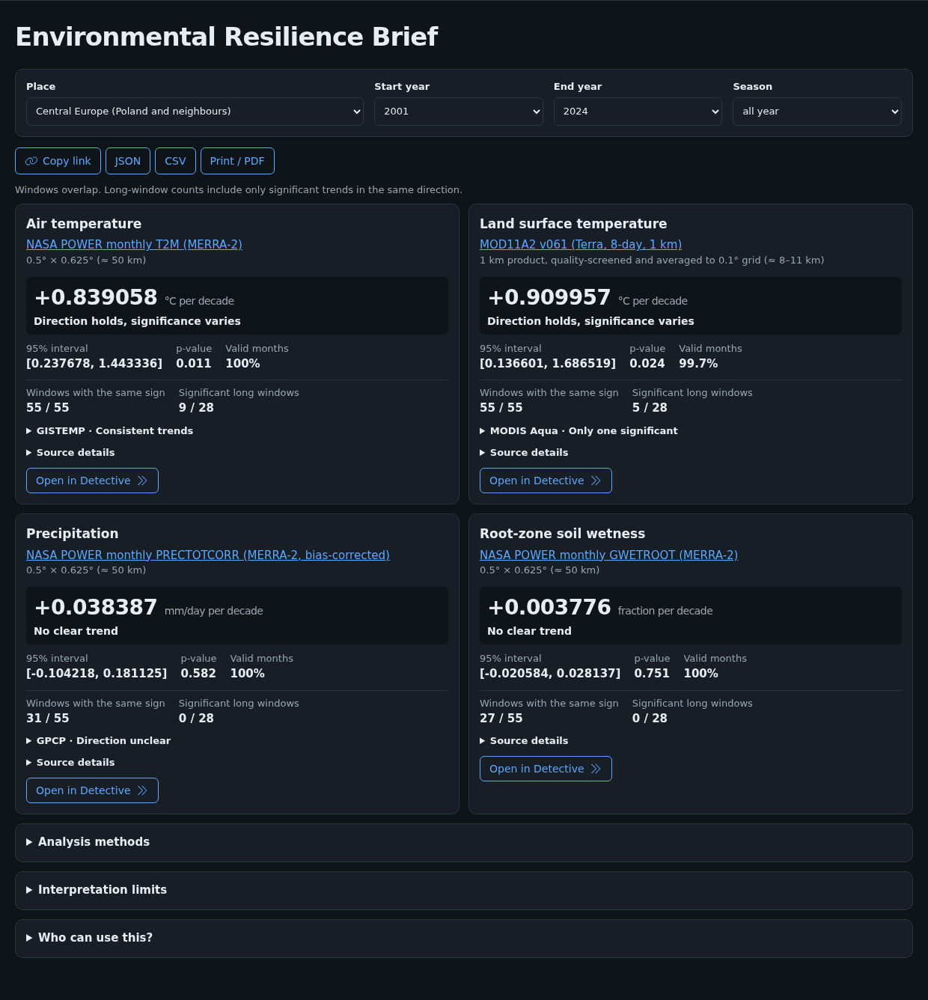

# Earth Evidence Atlas

### Follow the trend. Check the evidence.

An interactive Earth-system investigation tool built by **PollubAI** for the **NASA Space Apps Challenge 2026**, challenge **Be An Earth System Trend Detective!** Explore NASA observations and model products, pick a variable and a region, and test how much confidence a trend deserves.

**[View the presentation](https://git-maks.github.io/earth-evidence-atlas/)** · **[Seven-slide PDF](https://git-maks.github.io/earth-evidence-atlas/earth-evidence-atlas.pdf)**



## About this repository

The complete working application: backend, frontend, tests, the prebuilt data cubes and the pitch deck. The hosted demo server used during the hackathon has been taken offline; run it locally as described below.

- `atlas/`, `web/`, `scripts/`, `tests/` – application code.
- `data/cubes/` and `data/custom_regions.json` – prebuilt NetCDF data cubes and saved regions (about 105 MB). Raw downloads are not included and can be rebuilt.
- `presentation/` – the standalone seven-slide deck published on GitHub Pages, with its frozen evidence snapshot.
- `docs/HANDOFF.pl.md` – detailed team notes in Polish.

## What you can explore

| View | What it helps you investigate |
| --- | --- |
| **Globe** | Navigate Earth, switch imagery and analytical layers, select an area and inspect regional change. |
| **Trend detective** | Examine a time series, trend rate, confidence interval, seasonal selection and sensitivity to the analysis period. |
| **False alarms** | Use explicitly synthetic experiments to see how temporal memory and outliers can produce misleading trends. |
| **Resilience** | Compare environmental trends across variables for regional infrastructure screening, with links to the underlying analyses. |
| **Methods** | Inspect statistical assumptions, data provenance, quality screening, comparisons and limitations. |

The frontend also includes a guided tour, several languages, result exports and shareable analysis links.

### From the map to the evidence



### Learn why a convincing line can mislead



### Read regional environmental exposure across variables



These screenshots are recorded views of the real application from 15 November 2026. Small visual details may differ from the latest source.

## Run it locally

The code targets **Python 3.11**. Node is optional for the JavaScript regression checks. No frontend build step is required.

```bash
python3.11 -m venv .venv
.venv/bin/python -m pip install -r requirements.txt
.venv/bin/python -m pytest -q
scripts/run.sh 8765
```

Open http://127.0.0.1:8765/. The prebuilt cubes in `data/cubes/` are enough to use every view. To rebuild data from the upstream services (network access, storage and time required):

```bash
.venv/bin/python -m scripts.build_data --force
```

## A guide for code reviewers

| Location | Responsibility |
| --- | --- |
| [`atlas/stats.py`](atlas/stats.py) | Seasonal adjustment, trend estimation, uncertainty, rank-based checks, spatial aggregation and multiple-testing correction. |
| [`atlas/answers.py`](atlas/answers.py) | Deterministic explanatory templates filled with computed results. |
| [`atlas/api.py`](atlas/api.py) | FastAPI routes, analysis/export endpoints, region computation and Resilience reports. |
| [`atlas/config.py`](atlas/config.py) | Variable and region catalog, citations, units, licenses and caveats. |
| [`atlas/sources/`](atlas/sources/) | NASA POWER, MODIS, GISTEMP and GPCP adapters and common data-cube helpers. |
| [`web/`](web/) | Build-free browser application: MapLibre, Leaflet, Plotly, translations, guided tour and report views. |
| [`scripts/build_data.py`](scripts/build_data.py) | Retrieval and preparation of data cubes. |
| [`tests/`](tests/) | Synthetic statistical checks, API checks and browser-logic regressions exercised through Node where available. |

**Suggested review path:** start with the catalog and provenance, follow one analysis through `api.py` into `stats.py`, inspect the interpretation in `answers.py`, then examine the frontend and the synthetic regression tests.

## Data and scientific interpretation

Eight analytical series cover MODIS vegetation greenness and Terra/Aqua land-surface temperature, NASA POWER/MERRA-2 air temperature, precipitation and root-zone soil wetness, GPCP precipitation, and GISTEMP temperature anomalies. The catalog in `atlas/config.py` is the authoritative list.

MODIS quality screening is applied before aggregation. Trend calculations account for temporal dependence; the interface exposes confidence intervals, period sensitivity and comparisons with other products. Those products can share inputs: agreement does not establish independence.

All scientific numbers come from data processing and statistical calculations. Detective's explanations use fixed templates rather than an online language model. Laboratory examples are explicitly synthetic.

## Sources, dependencies and credits

Data citations, product-specific licenses and limitations are retained in [`atlas/config.py`](atlas/config.py). Sources include **NASA MODIS, POWER/MERRA-2, GISTEMP, NASA/NOAA GPCP**, and **NASA GIBS** imagery/legends. MODIS access uses Microsoft Planetary Computer's COG mirror of NASA LP DAAC products.

Bundled browser resources:

| Resource | Credit / license |
| --- | --- |
| MapLibre GL JS | MapLibre contributors; BSD-3-Clause. |
| Leaflet | Leaflet contributors; BSD-2-Clause. |
| Plotly.js | Plotly contributors; MIT. |
| TopoJSON client | Mike Bostock and contributors; ISC. |
| Natural Earth boundaries | Natural Earth; public domain. |
| Yale Bright Star Catalogue via d3-celestial | Catalog data from the existing application; d3-celestial package BSD-3-Clause. |
| NASA GIBS legends and imagery | NASA EOSDIS GIBS; source attribution is retained in the application. |
| `web/fonts/nasalization.ttf` | Team-supplied Ray Larabie font; embedded metadata “Freeware by Ray Larabie 1997”, internal family “Nasa”. |
| Icon sprite and favicon | Supplied/created by the project team. |
| Screenshots | Captured from Earth Evidence Atlas; underlying data/map credits apply. |

Python dependencies are listed in `requirements.txt`: FastAPI, Uvicorn, NumPy, SciPy, pandas, xarray, netCDF4, h5netcdf, Rasterio, pystac-client, planetary-computer, HTTPX, pytest and earthaccess. Their upstream licenses apply. The presentation's own assets and credits are listed in [`presentation/README.md`](presentation/README.md).

## Team PollubAI

| Team member | Focus |
| --- | --- |
| **Maks Kozieł** | Platform & Reliability – backend, data pipelines, operations and reliability. |
| **Jan Kwapiński** | Science & Data – methods, statistics, data quality and validation. |
| **Maja Sykuła** | Product & Experience – concept, UX/UI, frontend and user value. |
